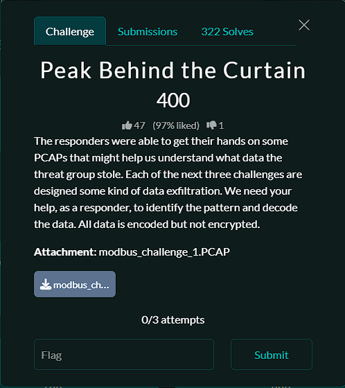

# Challenge Name: Peak Behind the Curtain
## Challenge


<!-- Remember to change the image path if you stored it elsewhere (e.g., ../../assets/challenge.png) -->

## Solution
1. Find Modbus conversation (filter: tcp.port == 502)

Port `502` appears as the destination of the client’s connection attempts. Using `tcp.port` keeps **both directions**, so I could see how the connection was established and compare requests with responses.

| Frames | Traffic | What it tells us |
| --- | --- | --- |
| 1–10 | SYNs from client port `35079`, followed by resets | These early attempts did not establish a connection. |
| 11–13 | SYN → SYN/ACK → ACK | A new connection was established from `192.168.88.163:35207` to `192.168.88.248:502`. |
| 14 | Modbus/TCP **Query**, function `16` | The client sent a **Write Multiple Registers** request. |
| 16 | Modbus/TCP **Response**, function `16` | The server returned a normal write response. |

The port helped locate the conversation. Wireshark’s **Modbus** details identified the actual operation.

2. Keep the requests that carry register values (filter: tcp.dstport == 502 && modbus.func_code == 16)
The following filter keeps only function 16 messages **going to** the server

- `tcp.dstport == 502` keeps the client-to-server direction. The reply goes the other way, from port `502` to `35207`.
- `modbus.func_code == 16` keeps the register writes and drops packets that have no Modbus command, such as the TCP handshake.
- `&&` requires both conditions.

The direction matters because a normal Modbus function 16 **response** also uses function code 16. It reports the starting address and quantity written, while the **request** contains the actual values


3. Inspect what changes between writes

In frame `14`, expand **Modbus** in the packet details pane:

| Wireshark field | Value | Interpretation |
| --- | --- | --- |
| Function Code | `16` (`0x10`) | Write Multiple Registers |
| Reference Number | `0` | Start at wire address `0`. |
| Word Count | `1` | Write one register. |
| Byte Count | `2` | The value occupies two bytes, or 16 bits. |
| Register Value (UINT16) | `47` | The register bytes are `00 2F`. |

Despite the name **Write Multiple Registers**, function 16 accepts a quantity of one. The **Word Count** tells you how many registers this particular request writes. The **Reference Number** tells you where it starts.

The 15 bytes of TCP payload in frame `14` break down as follows. These are the **Modbus/TCP message bytes**, without the surrounding IP and TCP headers.

```text
MBAP header:  00 01 | 00 00 | 00 09 | 01
              trans.  proto.  length  unit

Modbus PDU:   10   | 00 00   | 00 01   | 02         | 00 2F
              func.  start     quantity  byte count   register value
```

Comparing later **Query** rows shows the pattern: **same address, same quantity, varying value**. In this capture, the high byte of every register value is `00`. The low byte gives an ASCII character:

| Frame | Register bytes | Decimal value | ASCII character |
| --- | --- | ---: | --- |
| 14 | `00 2F` | 47 | `/` |
| 17 | `00 2F` | 47 | `/` |
| 20 | `00 34` | 52 | `4` |
| 22 | `00 4E` | 78 | `N` |
| 24 | `00 41` | 65 | `A` |
| 26 | `00 41` | 65 | `A` |

That gives the beginning of the encoded text: `//4NAA`. A single value like `47` does not prove that the data is Base64. The evidence comes from joining **all** the values and checking that the resulting text decodes successfully.

4. Reconstruct the characters in TCP order
The Modbus transaction identifier is `1` throughout this stream, so it cannot tell us the order of the characters. I used the client’s **TCP sequence number**, which tracks where its bytes belong in the stream.

**Deduplicate by TCP position, never by register value.** Frames `14` and `17` both carry `00 2F` but start at different sequence positions, so both slashes belong in the message. In contrast, frames `3006` and `3009` carry the same payload at the same relative TCP sequence number, `22426`. The latter is a retransmission. A raw packet count gives **2,977** client payloads; after removing that duplicate there are **2,976** characters.

5. Export and decode
Run this from the directory containing the capture. The command uses the same request filter as Wireshark and exports tab-separated fields:

```bash
tshark -r modbus_challenge_1.PCAP \
  -Y 'tcp.dstport == 502 && modbus.func_code == 16' \
  -T fields -e frame.number -e tcp.stream -e tcp.seq \
  -e modbus.reference_num -e modbus.word_cnt -e modbus.regval_uint16 \
  > writes.tsv
```

On macOS, if `tshark` is not on your `PATH`, try `/Applications/Wireshark.app/Contents/MacOS/tshark` in place of `tshark`. In my TShark run, frame `3009` was shown as TCP retransmission traffic without a decoded Modbus function, so the export already contained **2,976** rows. The script below still checks for duplicates and conflicting values.

Save this as `decode.py` and run `python3 decode.py`:

```python
import base64
from pathlib import Path

writes = {}
streams = set()

for line in Path("writes.tsv").read_text().splitlines():
    frame, stream, seq, address, count, value = map(int, line.split("\t"))
    streams.add(stream)

    # Verify the pattern before taking one byte from each write.
    if (address, count) != (0, 1) or not 0 <= value < 128:
        raise ValueError(f"Unexpected register write in frame {frame}")

    # This export contains only the client direction.
    key = (stream, seq)
    if key in writes and writes[key] != value:
        raise ValueError(f"Conflicting data at TCP position {key}")
    writes[key] = value

if len(streams) != 1:
    raise ValueError("Expected one TCP stream")

# Values fit in one byte, so bytes(...) keeps the low byte of each register.
encoded = bytes(writes[key] for key in sorted(writes))
decoded = base64.b64decode(encoded, validate=True)

if not decoded.startswith(b"\xff\xfe"):
    raise ValueError("Expected a UTF-16LE byte-order mark")

print(f"Recovered {len(encoded)} Base64 characters.")
text = decoded.decode("utf-16")  # The BOM selects little-endian decoding.
print(next(line for line in text.splitlines() if line.startswith("Your flag is:")))
```

The assembled text starts with `//4NAAoATgBBAE0ARQ...`. Base64 decoding yields **2,232 bytes** whose first bytes are:

```text
FF FE 0D 00 0A 00 4E 00 41 00 4D 00 45 00
```

`FF FE` is the **UTF-16 little-endian byte-order mark**. The next bytes decode to a line break followed by `NAME`. Decoding the entire buffer as UTF-16 produces readable text beginning with a PowerShell `Get-Process` help section. The flag is on the line labeled `Your flag is:`; there is no need to run anything from the recovered text. See the [Python Unicode codec documentation](https://docs.python.org/3/library/codecs.html#encodings-and-unicode).

The two byte-order details apply at **different layers**: Modbus carries the register value most-significant byte first (`00 2F`), while the **decoded Base64 payload** contains UTF-16LE text. Keep those stages separate.


**Flag:**
3xf1L_D@t@_B@s364
