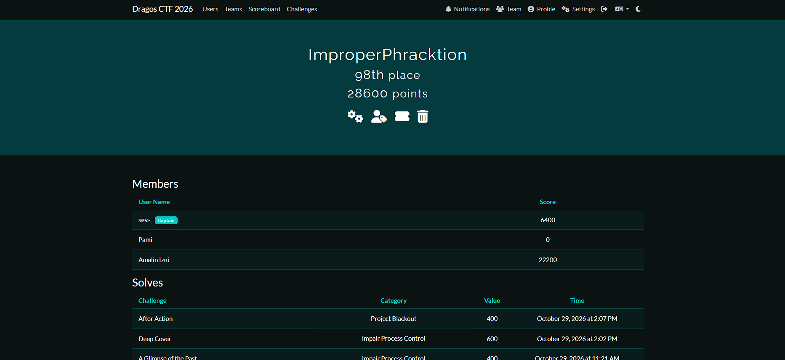

# Dragos CTF 2026 Writeups 🛡️

Welcome to our team's writeup repository for the **Dragos Capture the Flag 2026**! This repository contains our detailed methodologies, tools, and step-by-step solutions for the challenges we tackled during the event, focusing on Operational Technology (OT) and Industrial Control Systems (ICS) cybersecurity.

## 🏆 Team Performance: ImproperPhracktion

We are proud to share our results from the competition. 

<!-- Replace 'assets/scoreboard.png' with the actual path to your image in this repo -->


*   **Team Name:** ImproperPhracktion
*   **Final Placement:** 98th Place
*   **Total Score:** 28,600 points

### 👥 The Team
A massive shoutout to the members who contributed to our solves during the event:
*   **sev-** *(Captain, myself)* — 6,400 points
*   **Amalin izni** — 22,200 points
*   **Pami** — 0 points

---

## 📂 Repository Structure

This repository is organized by challenge category. Inside each category, you will find a folder for the specific challenge topic, which contains the challenge files, our notes, and the final writeup.

```text
DragosCTF2026Writeup/
│
├── Category (e.g., Project Blackout)
│   └── Challenge Topic (e.g., After Action)
│       ├── README.md (The Writeup)
│       └── [Challenge Files]
│
└── Category (e.g., Impair Process Control)
    └── Challenge Topic (e.g., Deep Cover)
        └── ...